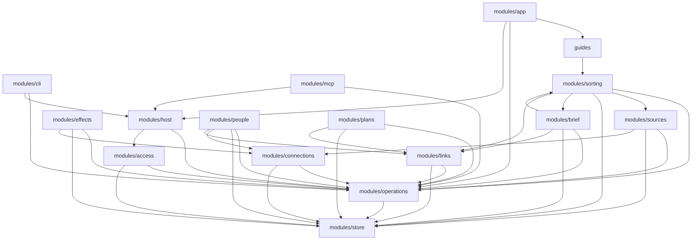

# Repository map

<!-- Generated by python -I _tools/map.py -->

Every arrow points toward the folder being read. The **Writes to** column below lists write handoffs separately.

All modules may read the [shared shapes](../contracts/CONTEXT.md). Each module contract links the shapes it needs.

See the [target map](target.md) for how the finished application will work. That picture points along a call. This map points toward the contract a part reads.

| Folder contract | Build step | Contract status | Outputs | Writes to |
| --- | --- | --- | --- | --- |
| [guides](../guides/CONTEXT.md) | — | Draft | Set-up recipes, Sorting guide | — |
| [modules/access](../modules/access/CONTEXT.md) | 1 (draft) | Draft | Caller and level | — |
| [modules/app](../modules/app/CONTEXT.md) | 1 (draft) | Draft | Screens and advice | — |
| [modules/brief](../modules/brief/CONTEXT.md) | 1 (draft) | Draft | Matters | — |
| [modules/cli](../modules/cli/CONTEXT.md) | 1 (draft) | Draft | Printed results | — |
| [modules/connections](../modules/connections/CONTEXT.md) | 1 (draft) Mail: 1 (proposed, draft), Sending: 2 (proposed, draft), Calendar and contacts: 6 (proposed, draft) | Draft | Account sign-ins | — |
| [modules/effects](../modules/effects/CONTEXT.md) | 2 (draft) Reply: 2 (proposed, draft), Text reply: 3 (proposed, draft), Events and contacts: 6 (proposed, draft) | Draft | Prepared actions | — |
| [modules/host](../modules/host/CONTEXT.md) | 1 (draft) | Draft | Routed requests | — |
| [modules/links](../modules/links/CONTEXT.md) | 1 (draft) Projects: 5 (proposed, draft) | Draft | Links | — |
| [modules/mcp](../modules/mcp/CONTEXT.md) | 1 (draft) | Draft | Agent tools | — |
| [modules/operations](../modules/operations/CONTEXT.md) | 1 (draft) | Draft | Checked calls | — |
| [modules/people](../modules/people/CONTEXT.md) | 1 (draft) Name on the line: 1 (proposed, draft), The page: 5 (proposed, draft), Google Contacts: 6 (proposed, draft) | Draft | Person pages | — |
| [modules/plans](../modules/plans/CONTEXT.md) | 5 (draft) | Draft | Projects and goals | — |
| [modules/sorting](../modules/sorting/CONTEXT.md) | 1 (draft) | Draft | Outcomes and receipts | — |
| [modules/sources](../modules/sources/CONTEXT.md) | 1 (draft) Mail: 1 (proposed, draft), Text: 3 (proposed, draft), Calls: 4 (proposed, draft) | Draft | Source messages | — |
| [modules/store](../modules/store/CONTEXT.md) | 1 (draft) | Draft | Stored rows | — |
