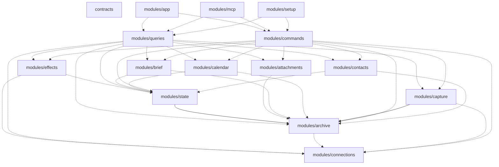

# Repository map

<!-- Generated by python -I _tools/map.py -->

Dotted arrows show module references. Plain arrows show write handoffs. Shared shapes are open to every module and are linked from its contract.

See the [target map](target.md) for how the finished application will work.

| Folder contract | Build step | Outputs |
| --- | --- | --- |
| [contracts](../contracts/CONTEXT.md) | — | Versioned handoff specifications |
| [modules/app](../modules/app/CONTEXT.md) | 2 (proposed) | Application screens |
| [modules/archive](../modules/archive/CONTEXT.md) | 1 (decided) | Readable originals, Readable saved decisions and receipts, Versioned manifest, Backups and restored records |
| [modules/attachments](../modules/attachments/CONTEXT.md) | 3 (proposed) | Attachment previews, Attachment export |
| [modules/brief](../modules/brief/CONTEXT.md) | 2 (proposed) | Source-linked Brief |
| [modules/calendar](../modules/calendar/CONTEXT.md) | 4 (proposed) | Proposed events, Booked event views |
| [modules/capture](../modules/capture/CONTEXT.md) | 1 (decided) | Captured records with stable source IDs |
| [modules/commands](../modules/commands/CONTEXT.md) | 1 (decided) to 2 (proposed) | Write command catalog, Write previews, Write receipts |
| [modules/connections](../modules/connections/CONTEXT.md) | 1 (decided) | Account connection status, Authorized connection access |
| [modules/contacts](../modules/contacts/CONTEXT.md) | 3 (proposed) | Contact links, Contact views |
| [modules/effects](../modules/effects/CONTEXT.md) | 4 (proposed) | External action receipts |
| [modules/mcp](../modules/mcp/CONTEXT.md) | 3 (proposed) | Agent access to commands and queries |
| [modules/queries](../modules/queries/CONTEXT.md) | 1 (decided) to 2 (proposed) | Query catalog, Read results |
| [modules/setup](../modules/setup/CONTEXT.md) | 1 (decided) | First-run setup flow |
| [modules/state](../modules/state/CONTEXT.md) | 2 (proposed) | Committed workflow state, Saved decisions and action receipts |
