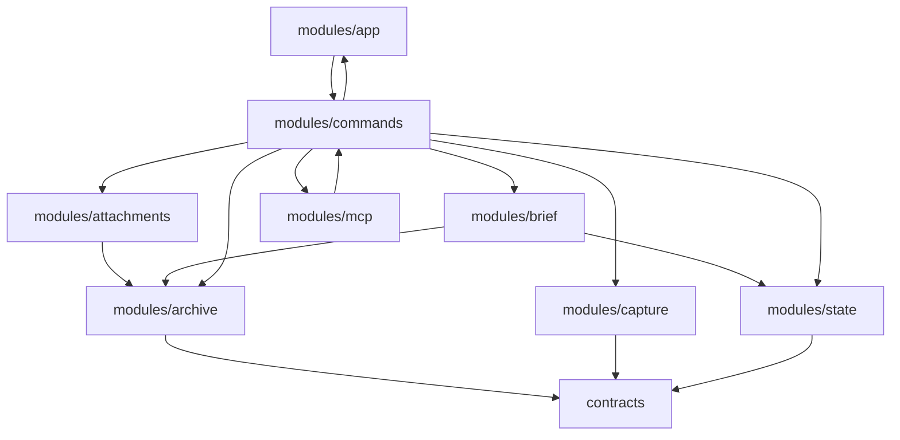

# Repository map

<!-- Generated by python -I _tools/map.py -->

Arrows point to contracts a folder may read.

| Folder contract | Outputs |
| --- | --- |
| [contracts](../contracts/CONTEXT.md) | Versioned handoff specifications |
| [modules/app](../modules/app/CONTEXT.md) | Application screens |
| [modules/archive](../modules/archive/CONTEXT.md) | Readable originals, Versioned manifest, Backup and restore result |
| [modules/attachments](../modules/attachments/CONTEXT.md) | Attachment previews, Attachment export |
| [modules/brief](../modules/brief/CONTEXT.md) | Source-linked Brief |
| [modules/capture](../modules/capture/CONTEXT.md) | Captured records |
| [modules/commands](../modules/commands/CONTEXT.md) | Command catalog, Command results, Write previews, Write receipts |
| [modules/mcp](../modules/mcp/CONTEXT.md) | MCP command access |
| [modules/state](../modules/state/CONTEXT.md) | Committed workflow state |
