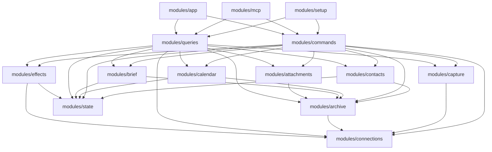

# Repository map

<!-- Generated by python -I _tools/map.py -->

Every arrow points toward the folder being read. The **Writes to** column below lists write handoffs separately.

All modules may read the [shared shapes](../contracts/CONTEXT.md). Each module contract links the shapes it needs.

See the [target map](target.md) for how the finished application will work.

| Folder contract | Build step | Contract status | Outputs | Writes to |
| --- | --- | --- | --- | --- |
| [modules/app](../modules/app/CONTEXT.md) | 2 (proposed) | Draft | Application screens | — |
| [modules/archive](../modules/archive/CONTEXT.md) | 1 (decided) Storage: 4 (proposed, draft) | Step 1 complete, later lanes draft | Readable originals, Readable saved decisions and receipts, Versioned manifest, Backups and restored records, Evidence folder access, Backup list for commands, Restore preview for commands, Restored decisions and receipts for commands | — |
| [modules/attachments](../modules/attachments/CONTEXT.md) | 3 (proposed) | Draft | Attachment previews, Attachment export | — |
| [modules/brief](../modules/brief/CONTEXT.md) | 2 (proposed) | Draft | Source-linked Brief | [state](../modules/state/CONTEXT.md) |
| [modules/calendar](../modules/calendar/CONTEXT.md) | 4 (proposed) | Draft | Proposed events, Booked event views | [state](../modules/state/CONTEXT.md) |
| [modules/capture](../modules/capture/CONTEXT.md) | 1 (decided) Mail: 1 (decided), Text: 3 (proposed, draft), Calls: 4 (proposed, draft), Import: 3 (proposed, draft) | Step 1 complete, later lanes draft | Captured records with stable source IDs, Capture outcome for commands | [archive](../modules/archive/CONTEXT.md) |
| [modules/commands](../modules/commands/CONTEXT.md) | 1 (decided) to 2 (proposed) | Step 1 complete, step 2 draft | Write command catalog, Write previews, Command receipts, Backup list for setup, Capture and restore progress for state, Restored decisions and receipts for state | [archive](../modules/archive/CONTEXT.md), [capture](../modules/capture/CONTEXT.md), [connections](../modules/connections/CONTEXT.md), [state](../modules/state/CONTEXT.md), [brief](../modules/brief/CONTEXT.md), [effects](../modules/effects/CONTEXT.md) |
| [modules/connections](../modules/connections/CONTEXT.md) | 1 (decided) | Complete | Account connection status, Authorized connection access | — |
| [modules/contacts](../modules/contacts/CONTEXT.md) | 3 (proposed) | Draft | Contact links, Contact views | [state](../modules/state/CONTEXT.md) |
| [modules/effects](../modules/effects/CONTEXT.md) | 4 (proposed) | Draft | External action receipts | [state](../modules/state/CONTEXT.md) |
| [modules/mcp](../modules/mcp/CONTEXT.md) | 3 (proposed) | Draft | Agent access to commands and queries | — |
| [modules/queries](../modules/queries/CONTEXT.md) | 1 (decided) to 2 (proposed) | Step 1 complete, step 2 draft | Query catalog, Read results | — |
| [modules/setup](../modules/setup/CONTEXT.md) | 1 (decided) | Complete | First-run setup flow | — |
| [modules/state](../modules/state/CONTEXT.md) | 1 (decided) to 2 (proposed) | Step 1 complete, step 2 draft | Capture and restore progress, Restored workflow state, Restore result for commands, Committed workflow state, Saved decisions and action receipts | [archive](../modules/archive/CONTEXT.md) |
