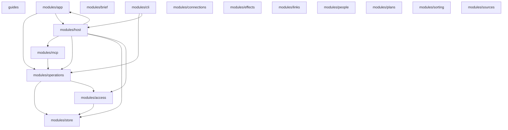

# Repository map

<!-- Generated by python -I _tools/map.py -->

An arrow appears when a piece writes a contract that reads another part. The **Writes to** column below lists write handoffs separately.

A shared shape is added in [contracts](../contracts/CONTEXT.md) by the piece whose code first uses it. Until then the [target map](target.md) is the plan.

See the [target map](target.md) for how the finished application will work. That picture points along a call.

| Folder contract | Piece | Contract status | Outputs | Writes to |
| --- | --- | --- | --- | --- |
| [guides](../guides/CONTEXT.md) | — | Draft | None | — |
| [modules/access](../modules/access/CONTEXT.md) | 1 (draft) | Draft | The caller of a request, The person's sign-in and the agent sign-ins | — |
| [modules/app](../modules/app/CONTEXT.md) | 1 (draft) | Draft | The bare screen: a form for every operation | — |
| [modules/brief](../modules/brief/CONTEXT.md) | 1 (draft) | Draft | None | — |
| [modules/cli](../modules/cli/CONTEXT.md) | 1 (draft) | Draft | The `diligent` command: one operation per command | — |
| [modules/connections](../modules/connections/CONTEXT.md) | 1 (draft) | Draft | None | — |
| [modules/effects](../modules/effects/CONTEXT.md) | 2 (draft) | Draft | None | — |
| [modules/host](../modules/host/CONTEXT.md) | 1 (draft) | Draft | The running program, The address of each operation, and the session cookie | — |
| [modules/links](../modules/links/CONTEXT.md) | 1 (draft) | Draft | None | — |
| [modules/mcp](../modules/mcp/CONTEXT.md) | 1 (draft) | Draft | The agent connection: every operation as a tool | — |
| [modules/operations](../modules/operations/CONTEXT.md) | 1 (draft) | Draft | The operations list, The door: one answer for one call | — |
| [modules/people](../modules/people/CONTEXT.md) | 1 (draft) | Draft | None | — |
| [modules/plans](../modules/plans/CONTEXT.md) | 5 (draft) | Draft | None | — |
| [modules/sorting](../modules/sorting/CONTEXT.md) | 1 (draft) | Draft | None | — |
| [modules/sources](../modules/sources/CONTEXT.md) | 1 (draft) | Draft | None | — |
| [modules/store](../modules/store/CONTEXT.md) | 1 (draft) | Draft | A store a part reads its own rows from and lands its writes through, The activity record and `activity_list` | — |
