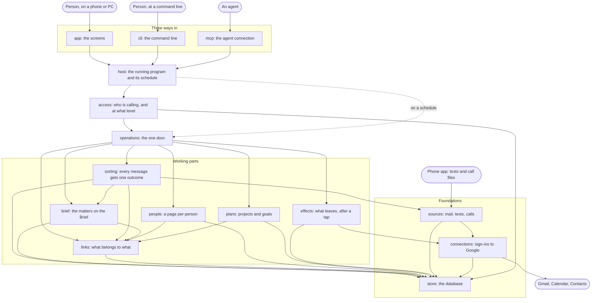

# Finished application target

Diligent shows one Brief of what needs the person. The Brief is built from their mail, texts and calls. An outside agent sorts and prepares. The person accepts with a tap. Mail is read when it is needed and is not kept. The program runs in the person's own Cloudflare account and is written so it can also run on a PC.

This is the target, a plan, not a contract. It may change a little as pieces are built. When a piece writes a part's contract, that contract is what holds. If it differs from this map, this map is corrected in the same change.

The [generated map](README.md) has no arrows yet. An arrow appears when a piece writes a contract that reads another part. The picture below points along a call. Counted as characters divided by four, this page is about 8,600 tokens, above the 8,000-token guide for one read.

## Words

- **Matter.** One line on the Brief. One thing that needs the person, however many messages are behind it.
- **Source message.** One mail, text or call that came in.
- **Operation.** One thing Diligent can do, with a fixed input, a fixed list of named results, the level it needs, and a record of who did it. Every screen button, command and agent tool is an operation.
- **Seam.** Where two parts meet. A seam is the operations a part offers, their named results, the shapes it shares and its hard rules. It is written with that part's code and tests. Until then this map is the plan.
- **Worker.** The program as it runs inside Cloudflare.
- **D1.** Cloudflare's database. On a PC it is one local file.
- **MCP.** The open standard agents use to connect to a tool.
- **Token.** A long secret. The person is shown a new token once when it is made, and the agent presents it on every call. The command line does not show a token of the person's.
- **Password.** The person signs in with a long password, typed once per device. It is stored only as a hash. Wrong tries are locked out. A passkey can be added later. It is not how the person signs in now.

## The picture

Everything comes in through one door. Mail is read from Gmail when it is needed and is not kept. Nothing leaves except through effects, and only after the person's tap.

operations writes its activity rows through store, because only store talks to the database.

## The parts

**app.** The screens: the Brief, a matter, a person, projects and goals, settings, and the first-run walk. The walk can be skipped, step by step. Built phone first on the Primer tokens published by GitHub (MIT). It owns layout and wording, and the advice shown beside a result. It never talks to the database or to Google. It only calls operations.

**cli.** A small program on the PC called `diligent`. The command line stays signed in as the person, once per device, like the screens. It never keeps the password. It keeps its session on that PC, and the install keeps only a hash of it. The command-line limit is rule 6. It also runs as a local bridge an agent can start (`diligent mcp`), for an agent that cannot hold a token itself. The bridge uses an agent sign-in of its own, which the person makes and gives it, and nothing else. It never uses the person's password. It prints what the operation returned and adds nothing of its own, so its output holds a mail's words only where the operation returns them (`sort_next` at the `full` level), and a sign-in only where the operation returns one (a new agent token, once). It prints a new agent token once and holds no other sign-in in its output. It owns nothing about mail or matters.

**mcp.** The agent connection. It offers the same operations as tools an agent can call. It accepts agent sign-ins only, so an operation that needs the person's level answers `not_allowed`. An agent's level stops at Prepare. It owns no behaviour of its own. A tool is an operation.

**host.** The running program. It takes each request, sends it to the right place, and runs the schedule. It owns the routes and the timer. It makes no decisions. Every outside request is identified before the door runs it. The schedule calls operations as `diligent`. It runs `cleanup_run` once a day. It runs `mail_check` at the interval the setting gives. It does not start an agent. On a PC a timer does the same.

**access.** Who is calling. The command line stays signed in as the person, once per device, like the screens. It never keeps the password. It keeps its session on that PC, and the install keeps only a hash of it. The command-line limit is rule 6. Every sign-in is kept only as a hash. That covers the password, agent tokens, the person's sessions and device sign-ins. Wrong tries are locked out. A passkey can be added later. A caller kind `device` is named for the phone app. Its sign-in is defined in piece three. Until then the seam only names it, recorded as `device:<id>`. It owns sign-ins to Diligent and the list of agents. It never holds a Google sign-in.

**operations.** The one door. It owns the level check, makes repeats safe, and writes the record of who did what. What a caller may do depends on its sign-in, never on the way in. Every part's work is reached through it. It never contains the work itself. The list of operations is the table below.

**sorting.** Makes sure every source message ends with exactly one outcome: no action, linked to a matter, or held with a reason. It owns outcomes, sort runs and receipts, and the honest numbers at the top of the Brief. It never decides anything about a message. The agent or the person decides, and it records.

**brief.** The matters. It owns each matter's fields, state and dated history, and how the Brief is grouped and filtered. Each line shows its one main action, with Done and Source beside it. Lane is a tag and a filter, not a section. It never reads mail.

**links.** What belongs to what: a message to a matter, a matter to a person, later a matter to a project. It owns every link, who made it, who accepted it, and the undo. A link is never deleted, only marked removed.

**people.** The light record of people: one page per person with what was said, their open matters and their projects. It owns person records. Google Contacts stays the address book. A match, in piece 6, is done through connections. No pipelines, no marketing.

**plans.** Projects and goals. Both are standalone and both are built from one block: steps with dates. A project and a goal each have their own ID. It owns projects, goals and steps. It holds the conversation side only. Estimates, costs and bills stay in the person's other apps, linked. Prepare may suggest a step. That suggestion writes nothing until the person accepts, and it does not create, edit or close one.

**effects.** Anything that leaves Diligent or changes Gmail, Calendar or Contacts: a reply, an event, a contact change. It owns prepared actions, the acceptance of each, the sending, and the receipt. It never acts without a recorded acceptance by the person. It is the only part that asks connections to send, and only for an accepted action. connections does not check that acceptance. What a prepared reply may hold is rule 2.

**sources.** What exists at each source. For mail it notices new messages and reads one when asked, keeping nothing but its ID. How far back a newly connected mailbox is sorted is a setting, 14 days unless changed. For texts and call transcripts the words stay until store removes them, because they live nowhere else. It owns the list of source messages. It does not own a clock. It never stores a mail body.

**connections.** Sign-ins to outside accounts, Google first. It is the only part that holds or uses those sign-ins, and it makes calls to Google on behalf of other parts. Each outside sign-in is kept encrypted with a key that is not in the database. The encrypted sign-in lives only in this part's rows. A result, an activity line and a log hold no outside sign-in.

**store.** The database. It owns the tables, their upgrades, removing what has aged out, and the export for backup and restore. Only store talks to D1. Each part's rows are its own. It never stores a received mail body. What an export file leaves out, and what a host restore brings back, is in the storage section.

## Folder layout

Each part is a folder with a `CONTEXT.md`, and later `src/` and `test/`. Until its piece writes the contract, that file is a stub and this map is the plan.

| Folder | What it holds |
| --- | --- |
| `AGENTS.md`, `CLAUDE.md`, `README.md`, `CONTEXT.md` | Entry points and the repository guide |
| `contracts/` | The version rule. A shared shape is added here by the piece whose code first uses it |
| `map/` | The generated map and this target |
| `modules/app/` | Screens and the first-run walk |
| `modules/cli/` | The `diligent` command-line program |
| `modules/mcp/` | The agent connection |
| `modules/host/` | The running program, routes and schedule |
| `modules/access/` | The person's sign-in and agent sign-ins |
| `modules/operations/` | The one door |
| `modules/sorting/` | Outcomes, sort runs, receipts, freshness |
| `modules/brief/` | Matters |
| `modules/links/` | Links and their undo |
| `modules/people/` | People |
| `modules/plans/` | Projects, goals and steps |
| `modules/effects/` | Prepared actions, acceptance, sending, receipts |
| `modules/sources/` | Mail, text and call lanes |
| `modules/connections/` | Sign-ins to Google |
| `modules/store/` | Database, upgrades, clean-out, export |
| `guides/` | The set-up walk in words, a recipe per agent, and the sorting guide |
| `_templates/`, `_tools/` | The contract template and the map tools |

The phone app for texts, and the optional helper for rooted phones, are not in this repository yet. Whether they live here or in their own repository is decided at piece 3.

The Cloudflare settings file is added at the repository root with the first piece of code, with one program in the repository. Cloudflare's [one-click deploy](https://developers.cloudflare.com/workers/platform/deploy-buttons/) does not fully support a repository that holds several programs. That file is not part of the repository yet.

These folders are not part of this design: an evidence archive, an attachment export, a separate calendar part, and a separate first-run part. Calendar changes are a lane of effects. The first-run walk is in app. The recipes are in `guides/`.

## Rules every part keeps

1. **No model inside.** No part calls a model.
2. **No received mail body is stored.** A prepared reply is stored with its matter and holds only the new words, never the quoted original. A quote is at most 300 characters. A summary is at most 1,200. Those two limits are proposals, not a decision by the owner.
3. **One door, three ways in.** The screen, the command line and an agent call the same operation. What a caller may do depends on its sign-in, never on the way in. The agent connection accepts agent sign-ins only, so an operation at the person's level answers `not_allowed` there. A capability counts as finished only when it works all three ways.
4. **Every change records who did it.** The person, a named agent, a device (`device:<id>`), or Diligent itself on its schedule. The device sign-in is defined in piece three. Until then the seam only names that caller.
5. **A repeat is safe.** Only an operation that changes something takes a request ID, and only that answer is kept. `sort_next` and every other read take none, so no kept answer ever holds a message's words. `sign_in`, `sign_out` and `password_set` take none either: no answer and no value made from the password is kept for them. The same ID with the same input returns the same answer and changes nothing twice, except `agent_create`, whose kept answer and repeat return `created` without the token.
6. **Nothing leaves without a tap.** Any program that can run commands on that PC, an agent included, can act through a signed-in command line at the person's level. Only effects reaches outward to change anything, and only for an action the person accepted. The Prepare level and the person's tap limit an agent that uses its own sign-in; they do not limit a program on the same PC as a signed-in command line, and nothing says the bridge rule does.
7. **Only connections holds outside sign-ins.**
8. **Not reachable is never gone, and never empty.** They are three different results. A mailbox that cannot be read is not reachable.
9. **Results say what was found, never what to do.** Every result has a name and a plain description that names what it is about. The screen gives the advice.
10. **Diligent never starts or wakes an agent.**
11. **One operation's changes land together or not at all.**
12. **What the person sets stays theirs.** A field the person edited on a matter is not overwritten by an agent. State is not one of those fields, so an agent may close again on a later message.

Any operation can also return `not_signed_in`, `not_allowed` (level too low), `switched_off`, `invalid_input`, `request_id_reused` (same ID, different input), `changed_since` (someone changed it first) and `unavailable`.

Operation names use lowercase and underscores (`sort_next`) so one name works as a command, an agent tool and a web address.

## Operations

Levels: **Read** (see everything), **Prepare** (Read, plus sort and prepare), **You** (everything). Prepare is the most an agent can hold. Until a piece writes that part's contract, this table is the list of operations.

| Part | Operation | Meaning | Level | Named results |
| --- | --- | --- | --- | --- |
| access | `sign_in` | The person signs in with the password. See the access rules | — | `signed_in`, `wrong_password`, `locked_out` |
| access | `sign_out` | End the session on this device | You | `signed_out` |
| access | `password_set` | Set the password. See the access rules | — | `set`, `wrong_code`, `not_allowed` |
| access | `whoami` | Who the caller is and its level | Read | `you`, `agent` |
| access | `agent_create` | Make an agent sign-in. See the access rules | You | `created`, `name_taken` |
| access | `agent_list` | Agents, levels, on or off, last used | You | `listed` |
| access | `agent_set` | Change an agent's level, or switch it off or on | You | `changed`, `unknown_agent` |
| access | `device_list`, `device_remove` | The person's signed-in devices | You | `listed`, `removed`, `last_device` |
| connections | `account_connect_start` | Begin connecting a mailbox. Returns an address to open in a browser | You | `open_this`, `no_google_setup` |
| connections | `account_connect_finish` | Receive Google's return, and only with the one-time value `account_connect_start` made | — | `connected`, `refused` |
| connections | `account_list` | Connected accounts and their state | Read | `listed` |
| connections | `account_disconnect` | Erase the sign-in. The account row stays | You | `disconnected`, `unknown_account` |
| sources | `mail_check` | Look for new mail in one account or all | You | `checked`, `needs_sign_in`, `not_reachable`, `rate_limited`, `already_checking` |
| sources | `source_open` | Where to open the original, checked live | You | `open_this`, `gone`, `not_reachable` |
| sources | `text_add` | The phone app brings in a text | device or You | `added`, `already_have` |
| sources | `call_add` | The phone app or a file brings in a transcript | device or You | `added`, `already_have` |
| sorting | `sort_status` | Per account: last check, waiting, held, last complete sort, last attempt | Read | `status` |
| sorting | `sort_start` | Open a sort run, or pick up the caller's own open run | Prepare | `started`, `resumed`, `run_open_elsewhere`, `nothing_waiting` |
| sorting | `sort_next` | The next few messages to sort, oldest first, at `handover_level`. `full` passes the words. `reference` means no request to Google is made because an agent asked. `full` unless changed. A read, so it takes no request ID | Prepare | `messages`, `none_left`, `run_ended` |
| sorting | `sort_record` | Record one message's outcome, including the matter changes the sorting rules name | Prepare | `recorded`, `not_in_run`, `unknown_matter`, `owner_field`, `too_long` |
| sorting | `sort_finish` | Close the run and return its receipt | Prepare | `receipt` |
| sorting | `sort_stop` | Stop a run | You, or the agent that owns the run | `receipt` |
| sorting | `sort_receipt` | The same receipt again | Read | `receipt`, `unknown_run` |
| sorting | `held_list`, `held_release` | See held messages. Send one back to be sorted | Read, and You for release | `listed`, `released` |
| brief | `brief_list` | The Brief, grouped by kind. The caller asks `sort_status` for the freshness line | Read | `brief` |
| brief | `matter_get` | One matter with its sources, the person id and history. The caller asks people for the page | Read | `matter`, `unknown_matter` |
| brief | `matter_search` | Find matters, including closed ones | Read | `found` |
| brief | `matter_edit` | Change title, notes, due date, kind or lane | You | `changed` |
| brief | `matter_set_state` | Done, Waiting, snooze, dismiss or reopen. This stays the person's. The person reopens a done matter with one tap | You | `changed`, `already_so` |
| links | `link_move_message` | Move a message from one matter to another | You | `moved`, `same_matter` |
| links | `link_accept_person`, `link_remove_person` | Accept or remove a person on a matter | You | `accepted`, `removed` |
| links | `matter_merge`, `matter_split` | Join two matters, or part one | You | `merged`, `split` |
| people | `person_list`, `person_get`, `person_edit` | The people and one person's page | Read, and You for the edit | `listed`, `person`, `changed` |
| plans | `project_*`, `goal_*`, `step_*` | Make, list, edit and close projects, goals and steps. Prepare may suggest steps | Read or You | `listed`, `changed`, `suggested` |
| effects | `action_prepare` | Prepare a reply, an event or a contact change. Nothing is sent | Prepare | `prepared` |
| effects | `action_list`, `action_get` | What is waiting for a tap, with the exact change | Read | `listed`, `action` |
| effects | `action_edit`, `action_discard` | Change or drop a prepared action | You | `changed`, `discarded` |
| effects | `action_accept` | The person's tap. It is carried out once | You | `done`, `failed`, `outcome_unknown`, `needs_sign_in` |
| store | `activity_list` | Who did what | You | `listed` |
| store | `settings_get`, `settings_set` | Lanes, how long each kind is kept, how often mail is checked, `handover_level`, and how far back a new mailbox is sorted | Read, and You for the change | `settings`, `changed` |
| store | `export_make`, `export_restore` | A backup file of the Brief data, and putting one back into an empty install. `not_empty` writes nothing | You | `made`, `restored`, `not_empty` |
| store | `cleanup_run` | Remove rows whose kept period has ended | — | `cleaned` |

Signing in to Google happens on Google's own page in a browser. That step cannot be done from a command line or by an agent. `account_connect_start` and `account_disconnect` need the person's level, so on the agent connection they answer `not_allowed`. `account_list` is Read, so an agent may see the state.

## Rules that belong to one part

- **sorting.** A source message has one current outcome, and its earlier outcomes stay in its history. One sort run is open at a time. A run with no activity for 30 minutes ends as `timed_out`. A message whose account cannot be read is left waiting, and the run's receipt counts it as left waiting. A run's receipt never changes once given. "Last complete sort" for an account moves only when a run ends with nothing left waiting for that account. A message that vanished before it was sorted is recorded as no action, reason "gone before sorting", by Diligent. A run's receipt says `complete` only when every listed message is in its counts and none are left waiting. `handover_level` is `full` or `reference`, `full` unless changed. `reference` means no request to Google is made because an agent asked. `sort_next` offers messages oldest first. For a `linked` outcome, `sort_record` may create a matter or update an existing one's sorted fields (title, next action, who owes it, summary, latest update, timing, kind, lane, main action), attach the message with its short quote, and propose a person for the matter. A proposed person is unconfirmed until the person accepts. It never overwrites a field the person set (`owner_field`). The two state changes it may make, and no others, are a close, to `done`, from `open`, `waiting` or `snoozed`, and a reopen, from `done` to `open`, when the linked message happened after the matter was closed. It never changes a dismissed matter. Only the person reopens a dismissed matter. The link that carries a close does not reopen the matter. The reopen is part of the `sort_record` that links the message, and it is recorded under its caller.
- **brief.** A matter's ID never changes and is never reused. Every change adds a history line. `matter_set_state` stays the person's. The state changes a sort may make are the sorting rules. The person reopens a done matter with one tap. When a linked message can no longer be found at its source, the matter stays with its summary, quote and history, and shows "source no longer available". The freshness line is sorting's; the caller asks `sort_status`. `matter_get` returns the person id; the caller asks people. Lines marked Waiting stay visible under a Waiting filter, and details are edited in place. Remembered columns and layout wait for the PC table view.
- **links.** A message-to-matter link made by sorting is in force at once. A person link proposed by an agent shows as unconfirmed until the person accepts it. Piece 1's undo is `link_move_message` and `link_remove_person`, with `link_accept_person`. `matter_merge` and `matter_split` are later and belong to no piece yet. Undoing one of them, when they exist, is a new link change and does not erase the earlier line. A name in a message is not a verified contact.
- **sources.** A message is identified by its kind, Diligent's own ID for the account, and the provider's own message ID. That account ID is not a mail address. Reconnecting the same Google account keeps the same account ID. Mail is read from the provider's mail address only. This part never sees the sign-in. A mailbox that cannot be read is not reachable. `gone` means the provider no longer has that message. A read from connections is `read`, `gone`, `needs_sign_in`, `not_reachable`, `rate_limited` (with the wait asked for, if any) or `refused_address`. `already_have` means that text or transcript is already stored. A file the person brings in comes through calls in piece 4. How far back a newly connected mailbox is sorted is a setting, 14 days unless changed. This part does not own a clock.
- **connections.** The lasting states are `connected`, `needs-sign-in` and `disconnected`. A disconnect erases the sign-in and leaves the account's row, with Diligent's ID for it and the provider's lasting ID, in `disconnected`. Account rows are kept until the person deletes them. Each outside sign-in is kept encrypted with a key that is not in the database, and that sign-in lives only in this part's rows. A sign-in that Google rejects becomes `needs-sign-in` and stays so until the person signs in again. A network failure changes nothing. Mail is read over HTTPS from the provider's mail address only, and a redirect elsewhere is refused, and the sign-in is not attached. A failure has one name. A read returns `read`, `gone`, `needs_sign_in`, `not_reachable`, `rate_limited` (with the wait asked for, if any) or `refused_address`. From piece two a send returns `sent`, `failed`, `outcome_unknown` or `needs_sign_in`. This part does not check whether a send was accepted.
- **effects.** An accepted action is carried out at most once. An unknown outcome is checked with the provider before any retry. An event that invites or notifies someone shows who gets notified before the tap. Only this part asks connections to send, and only for an accepted action. What a prepared reply may hold is rule 2.
- **guides.** A recipe stays inside the operations this map names. It holds no real mailbox, token or customer data. The sorting guide adds no rule of its own.
- **access.** The command-line limit is rule 6. Every sign-in is kept only as a hash. That covers the password, agent tokens, the person's sessions and device sign-ins. Wrong tries are locked out. A passkey can be added later. `agent_create` returns the token in its first `created` answer only. A repeat returns `created` without the token. No kept answer, row, backup, activity line or log holds it. The install keeps a hash. A lost token is replaced by making a new one. The bridge's agent sign-in is an agent token, never the person's password. A caller kind `device` is named for the phone app and defined in piece three. An agent that is switched off is refused at once, and its matters stay. `sign_in` and the first `password_set` are the only operations a caller with no session may call, apart from `account_connect_finish`, as its row says. `sign_in`, `sign_out` and `password_set` answer `not_allowed` on the agent connection. `password_set` on an install with no password takes a one-time set-up code that only someone who controls the install's own hosting account can read. How the code is made and shown is decided by the piece that builds sign-in. Once a password exists, `password_set` needs the person's session.

## Shared shapes

Until a piece writes code, the shapes below are the plan in this map. That piece adds the shape to [contracts](../contracts/CONTEXT.md), first and alone, when its code first uses it.

- **Matter.** `version` goes up with every change. `kind` is `money`, `do` or `reply`. `lane` is one of the person's lanes. The line is `title`, `next_action`, `owed_by`, `summary`, `latest_update` and `timing`. `owed_by` is the person, the other party, or a name. `state` is `open`, `waiting`, `snoozed` (until a date), `done` or `dismissed`. `main_action` is `reply`, `schedule`, `contact` or `none`. `notes` and `due` are the person's only. `set_by_you` lists the fields the person has edited.
- **Source message.** `kind` is `mail`, `text` or `call`. `account` is this install's ID for the account or phone, and `provider_id` is the provider's own ID. `thread`, the UTC times `happened_at` and `noticed_at`, and `hints`, which are label IDs from the mail client. `reachable` is `yes`, `gone` or `not_reachable`. `outcome` is none yet, `no_action`, `linked`, or `held` with a reason. `outcome_by`, `outcome_at` and `run` say who recorded it, when, and in which run. No subject, no sender, no body.
- **Person.** Identity, name, ways to reach them, and `confirmed` (`yes` or `no`).
- **Link.** The two ends. `kind` is a message to a matter, a matter to a person, or later a matter to a project. `state` is `proposed`, `active` or `removed`. It records who made it and when, who accepted it and when, and who removed it and when. A message link also carries a short quote, the sender's name and the date.
- **Agent.** Name, level (`read` or `prepare`), on or off, and when it was made and last used.
- **Sort run.** The agent, the times, and how it ended: `finished`, `stopped` or `timed_out`. The receipt counts, per account, offered, no action, linked, held, gone and left waiting, and says `complete` or `partial`.
- **Prepared reply.** See rule 2.
- **Who did it.** The person, `agent:<id>`, `device:<id>`, or Diligent.

## What is stored, and for how long

| Record | Holds | Kept |
| --- | --- | --- |
| Accounts | Label, address, Diligent's ID for the account, the provider's lasting ID, state, the sign-in while connected (encrypted with a key that is not in the database), a bookmark of how far mail was checked | Until the person deletes the row. The export file includes the row and no sign-in |
| Source messages | IDs, thread ID, two times, label IDs, reachable, outcome. No subject, no sender, no body | Linked ones as long as their matter. Others one year |
| Text and call words | The text of a text message or a call transcript | One year, then removed. Audio is never kept once transcribed |
| Matters | The matter fields | Until the person deletes them |
| Matter history | One short dated line per change, and who | With the matter |
| Links | The link fields, including a quote of at most 300 characters | With the matter |
| People, projects, goals, steps | As the parts describe | Until the person deletes them |
| Prepared actions | The prepared reply, as rule 2 says, who prepared it, the acceptance, the provider's receipt | With the matter |
| Agents, devices, sessions | Names, levels, and hashes of the password, agent tokens, sessions and device sign-ins | Until removed. Sessions end by themselves. The export file holds none of those sign-ins |
| Sort runs and receipts | Counts only | One year |
| Request IDs | The ID, a fingerprint of the input, and the answer of an operation that changes something. A read is not kept | 30 days |
| Activity | Time, who, which operation, on what, the result's name. No message content and no token | One year |
| Settings | Lanes, lengths, check interval, `handover_level`, how far back a new mailbox is sorted | Always |

The lengths are settings. Two checks are planned to show that no received mail body is stored: the tables have nowhere to put one, and an acceptance check sorts made-up mail containing a marker sentence and then searches the whole database for it. The prepared-reply exception is rule 2.

The year for unlinked message IDs, the 30 days for request IDs, and the two size limits are proposals, not decisions by the owner. The year for text and call words is the retention this design uses.

No backup holds a sign-in is a rule about the file `export_make` makes. That file leaves out every sign-in: outside sign-ins, the password hash, agent token hashes, sessions and device sign-ins. It holds no password. `export_restore` does not change the password of the install it is put into. After that file is put back, the person connects each account again and makes each agent's sign-in again. Backup and restore by that file are not in the six-piece order. The host can also restore the database to an earlier minute, for 7 days on the free host plan and 30 days on the paid one ([Time Travel](https://developers.cloudflare.com/d1/reference/time-travel/)). That host restore puts every row back as it was then, sign-ins included, so an agent switched off since then is on again and an erased sign-in is back. It stays available after the export file exists.

## Which piece first touches each part

| Part | 1 Mail to Brief | 2 Reply | 3 Texts | 4 Calls | 5 Projects and goals | 6 Calendar and contacts |
| --- | --- | --- | --- | --- | --- | --- |
| host, operations, access, store, cli, mcp, app | First | adds | adds | adds | adds | adds |
| connections | First, read mail, read-only | adds sending | | | | adds Calendar and Contacts |
| sources | First, mail | | adds texts | adds calls | | |
| sorting | First | | same rules | same rules | | |
| brief | First | | | | | |
| links | First, including `link_move_message` and `link_remove_person` | | | | adds project links | |
| people | First, a name on the line | | | | the page | Google Contacts |
| effects | | First | adds text replies | | | adds events and contacts |
| plans | | | | | First | |

A later piece adds operations and lanes. It does not change an operation an earlier piece shipped without changing the shared shape in `contracts/` first. `matter_merge` and `matter_split` are later and belong to no piece yet.

## One outside rule

On 2026-11-24 Google published the [Workspace AI Tools Addendum](https://workspace.google.com/terms/ai-tools), in force from 2027-02-01. A tool that reaches Google Workspace data, where that tool is or is driven by an AI agent, must use a Google MCP. Google's [announcement](https://workspaceupdates.googleblog.com/2026/11/mcp-servers-cli-standardized-usage-tiers-now-available.html) says agents must use Workspace MCP servers or the Workspace CLI to access Workspace data, rather than calling Workspace REST APIs directly. Technical enforcement begins on 2027-02-01. The dates are also on Google's [usage tiers page](https://developers.google.com/workspace/guides/quota-usage-tiers).

As designed, Diligent reads Gmail through that REST interface. `sort_next` can hand an agent each message at one of two levels:

- **`full`.** Diligent reads the mail from Gmail and passes the words through. Use starts at `full`.
- **`reference`.** Diligent passes only the message's IDs. The agent reads the mail through Google's own connection, which Google offers for Gmail ([set-up guide](https://developers.google.com/workspace/guides/configure-mcp-servers)), and records the outcome in Diligent as before.

Both levels are part of the seam.

In `reference`, no request to Google is ever made because an agent asked. The Brief, the outcomes, the receipts and the screen are the same either way. The cost of `reference` is set-up: each agent also needs Google's connection for each mailbox, and Google's free tier allows 5,000 such requests a day per project.

Whether this program counts as a tool driven by an agent under that addendum is a legal reading that is still open, before other people use it with their mail. That reading is [issue 18](https://github.com/diligent-communications/diligent-communications/issues/18).
