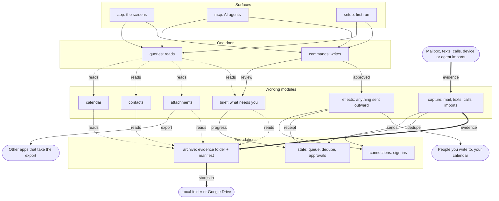

# Finished application target

Three ways in, one door, six working modules, three foundations.

Thick arrows are evidence coming in. Dotted arrows are reads. Plain arrows are approved actions and their receipts.

Three owners of the truth:

- **What happened** lives in `archive`. Originals are never rewritten.
- **What it means** lives in `brief`, `contacts`, `calendar` and `attachments`, with progress in `state`. All of it can be rebuilt from the archive.
- **What was done about it** lives in `effects`. A sent reply or a calendar write happens once, after approval, and leaves a receipt. It is never replayed on restore or retry.

Screens and agents use the same door, so a person and an agent never do the same thing two different ways. Things come in through `capture` only and go out through `effects` only.
