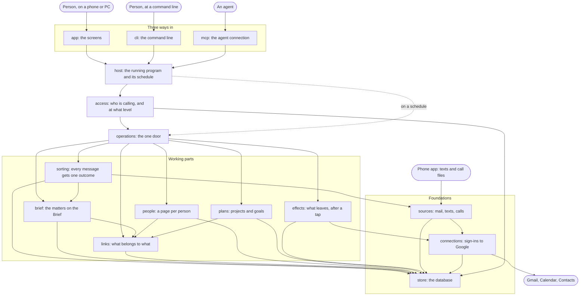

# Finished application target

Diligent shows one Brief of what needs the person. The Brief is built from their mail, texts and calls. An outside agent sorts and prepares. The person accepts with a tap. Mail is read when it is needed and is not kept. The program runs in the person's own Cloudflare account and is written so it can also run on a PC.

This is the target. It may change a little as pieces are built. The seam of each part is already the contract in that part's folder. What happens inside a part stays unwritten until its code is written.

The [generated map](README.md) points toward the contract a part reads. The picture below points along a call.

## Words

- **Matter.** One line on the Brief. One thing that needs the person, however many messages are behind it.
- **Source message.** One mail, text or call that came in.
- **Operation.** One thing Diligent can do, with a fixed input, a fixed list of named results, the level it needs, and a record of who did it. Every screen button, command and agent tool is an operation.
- **Seam.** Where two parts meet. A seam is the operations a part offers, their named results, the shapes it shares and its hard rules. Seams are complete in the part contracts. What happens inside a part stays draft until its code is written.
- **Worker.** The program as it runs inside Cloudflare.
- **D1.** Cloudflare's database. On a PC it is one local file.
- **MCP.** The open standard agents use to connect to a tool.
- **Token.** A long secret an agent or the command line shows to prove who it is.
- **Passkey.** A proposed way to sign in with the phone's fingerprint, face or PIN, and no password. How the person signs in on a phone is still open.

## The picture

Everything comes in through one door. Mail is read from Gmail when it is needed and is not kept. Nothing leaves except through effects, and only after the person's tap.

operations writes its activity rows through store, because only store talks to the database. That read is on the generated map.

## The parts

**app.** The screens: the Brief, a matter, a person, projects and goals, settings, and the first-run walk. Built phone first on the Primer tokens published by GitHub (MIT). It owns layout and wording, and the advice shown beside a result. It never talks to the database or to Google. It only calls operations.

**cli.** A small program on the PC called `diligent`. It sends an operation to the install with a token and prints the result. It also runs as a local bridge an agent can start (`diligent mcp`), for an agent that cannot hold a token itself. It owns nothing and stores only its own token.

**mcp.** The agent connection. It offers the same operations as tools an agent can call. It owns no behaviour of its own. A tool is an operation.

**host.** The running program. It takes each request, sends it to the right place, and runs the schedule. It owns the routes and the timer. It makes no decisions.

**access.** Who is calling. Two kinds of sign-in: the person's, and one per agent (a token with a level, which the person creates and can switch off). It owns sign-ins to Diligent and the list of agents. It never holds a Google sign-in. How the person signs in on a phone is still open; a passkey is proposed.

**operations.** The one door. It owns the level check, makes repeats safe, and writes the record of who did what. Every part's work is reached through it. It never contains the work itself. The list of operations is the tables below, and the same tables in the part contracts.

**sorting.** Makes sure every source message ends with exactly one outcome: no action, linked to a matter, or held with a reason. It owns outcomes, sort runs and receipts, and the honest numbers at the top of the Brief. It never decides anything about a message. The agent or the person decides, and it records.

**brief.** The matters. It owns each matter's fields, state and dated history, and how the Brief is grouped and filtered. It never reads mail.

**links.** What belongs to what: a message to a matter, a matter to a person, later a matter to a project. It owns every link, who made it, who accepted it, and the undo. A link is never deleted, only marked removed.

**people.** The light record of people: one page per person with what was said, their open matters and their projects. It owns person records. Google Contacts stays the address book. No pipelines, no marketing.

**plans.** Projects and goals. Both are standalone and both are built from one block: steps with dates. It owns projects, goals and steps. It holds the conversation side only. Estimates, costs and bills stay in the person's other apps, linked.

**effects.** Anything that leaves Diligent or changes Gmail, Calendar or Contacts: a reply, an event, a contact change. It owns prepared actions, the acceptance of each, the sending, and the receipt. It never acts without a recorded acceptance by the person.

**sources.** What exists at each source. For mail it notices new messages and reads one when asked, keeping nothing but its ID. For texts and call transcripts it keeps the words for one year, because they live nowhere else. It owns the list of source messages and the retention clock. It never stores a mail body.

**connections.** Sign-ins to outside accounts, Google first. It is the only part that holds or uses those sign-ins, and it makes calls to Google on behalf of other parts. Nothing secret ever appears in a result, a record or a log.

**store.** The database. It owns the tables, their upgrades, the yearly clean-out, and the export for backup and restore. Only store talks to D1. Each part's rows are its own.

## Folder layout

Each part is a folder with a `CONTEXT.md` (its seam), and later `src/` and `test/`.

| Folder | What it holds |
| --- | --- |
| `AGENTS.md`, `CLAUDE.md`, `README.md`, `CONTEXT.md` | Entry points and the repository guide |
| `contracts/` | Shared shapes, each with the version rule |
| `map/` | The generated map and this target |
| `modules/app/` | Screens and the first-run walk |
| `modules/cli/` | The `diligent` command-line program |
| `modules/mcp/` | The agent connection |
| `modules/host/` | The running program, routes and schedule |
| `modules/access/` | The person's sign-in and agent sign-ins |
| `modules/operations/` | The one door |
| `modules/sorting/` | Outcomes, sort runs, receipts, freshness |
| `modules/brief/` | Matters |
| `modules/links/` | Links and their undo |
| `modules/people/` | People |
| `modules/plans/` | Projects, goals and steps |
| `modules/effects/` | Prepared actions, acceptance, sending, receipts |
| `modules/sources/` | Mail, text and call lanes |
| `modules/connections/` | Sign-ins to Google |
| `modules/store/` | Database, upgrades, clean-out, export |
| `guides/` | The set-up walk in words, a recipe per agent, and the sorting guide |
| `_templates/`, `_tools/` | The contract template and the map tools |

The phone app for texts, and the optional helper for rooted phones, are not in this repository yet. Whether they live here or in their own repository is decided at piece 3.

The Cloudflare settings file is added at the repository root with the first piece of code, with one program in the repository. Cloudflare's [one-click deploy](https://developers.cloudflare.com/workers/platform/deploy-buttons/) does not fully support a repository that holds several programs. That file is not part of the repository yet.

These folders are not part of this design: an evidence archive, an attachment export, a separate calendar part, and a separate first-run part. Calendar changes are a lane of effects. The first-run walk is in app. The recipes are in `guides/`.

## Rules every part keeps

1. **No model inside.** No part calls a model.
2. **No mail body is stored.** There is no column for one. A quote is at most 300 characters. A summary is at most 1,200. Those two limits are proposals, not a decision by the owner.
3. **One door, three ways in.** The screen, the command line and an agent call the same operation with the same level check and the same record. A capability counts as finished only when it works all three ways.
4. **Every change records who did it.** The person, a named agent, or Diligent itself on its schedule.
5. **A repeat is safe.** Every change carries a request ID the caller makes up. The same ID with the same input returns the same answer and changes nothing twice.
6. **Nothing leaves without a tap.** Only effects reaches outward to change anything, and only for an action the person accepted.
7. **Only connections holds outside sign-ins.**
8. **Not reachable is never gone, and never empty.** They are three different results. A mailbox that cannot be read is not reachable.
9. **Results say what was found, never what to do.** Every result has a name and a plain description that names what it is about. The screen gives the advice.
10. **Diligent never starts or wakes an agent.**
11. **One operation's changes land together or not at all.**
12. **What the person sets stays theirs.** A field the person edited on a matter is not overwritten by an agent.

Any operation can also return `not_signed_in`, `not_allowed` (level too low), `switched_off`, `invalid_input`, `request_id_reused` (same ID, different input), `changed_since` (someone changed it first) and `unavailable`.

Operation names use lowercase and underscores (`sort_next`) so one name works as a command, an agent tool and a web address.

## Operations

Levels: **Read** (see everything), **Prepare** (Read, plus sort and prepare), **You** (everything). Prepare is the most an agent can hold. The part contract is the home for that part's operations. This table is the index.

| Part | Operation | Meaning | Level | Named results |
| --- | --- | --- | --- | --- |
| access | `whoami` | Who the caller is and its level | Read | `you`, `agent` |
| access | `agent_create` | Make an agent sign-in. The token is shown once | You | `created`, `name_taken` |
| access | `agent_list` | Agents, levels, on or off, last used | You | `listed` |
| access | `agent_set` | Change an agent's level, or switch it off or on | You | `changed`, `unknown_agent` |
| access | `device_list`, `device_remove` | The person's signed-in devices | You | `listed`, `removed`, `last_device` |
| connections | `account_connect_start` | Begin connecting a mailbox. Returns an address to open in a browser | You | `open_this`, `no_google_setup` |
| connections | `account_list` | Connected accounts and their state | Read | `listed` |
| connections | `account_disconnect` | Forget a sign-in. Matters stay | You | `disconnected`, `unknown_account` |
| sources | `mail_check` | Look for new mail in one account or all | You, and the schedule | `checked`, `needs_sign_in`, `not_reachable`, `rate_limited`, `already_checking` |
| sources | `source_open` | Where to open the original, checked live | You | `open_this`, `gone`, `not_reachable` |
| sources | `text_add`, `call_add` | The phone app or a file brings in a text or a transcript | Phone or You | `added`, `already_have` |
| sorting | `sort_status` | Per account: last check, waiting, held, last complete sort, last attempt | Read | `status` |
| sorting | `sort_start` | Open a sort run, or pick up the caller's own open run | Prepare | `started`, `resumed`, `run_open_elsewhere`, `nothing_waiting` |
| sorting | `sort_next` | The next few messages to sort. `full` passes the words. `reference` passes only the IDs. Whether an agent is handed a mail's words or only its IDs is still open | Prepare | `messages`, `none_left`, `run_ended` |
| sorting | `sort_record` | Record one message's outcome, with the matter change if it is linked | Prepare | `recorded`, `not_in_run`, `unknown_matter`, `owner_field`, `too_long` |
| sorting | `sort_finish` | Close the run and return its receipt | Prepare | `receipt` |
| sorting | `sort_stop` | Stop a run | You, or the agent that owns the run | `receipt` |
| sorting | `sort_receipt` | The same receipt again | Read | `receipt`, `unknown_run` |
| sorting | `held_list`, `held_release` | See held messages. Send one back to be sorted | Read, and You for release | `listed`, `released` |
| brief | `brief_list` | The Brief, grouped by kind, with the freshness line | Read | `brief` |
| brief | `matter_get` | One matter with its sources, person and history | Read | `matter`, `unknown_matter` |
| brief | `matter_search` | Find matters, including closed ones | Read | `found` |
| brief | `matter_edit` | Change title, notes, due date, kind or lane | You | `changed` |
| brief | `matter_set_state` | Done, Waiting, snooze, dismiss or reopen. Whether an agent may close a finished matter is still open | You | `changed`, `already_so` |
| links | `link_move_message` | Move a message from one matter to another | You | `moved`, `same_matter` |
| links | `link_accept_person`, `link_remove_person` | Accept or remove a person on a matter | You | `accepted`, `removed` |
| links | `matter_merge`, `matter_split` | Join two matters, or part one | You | `merged`, `split` |
| people | `person_list`, `person_get`, `person_edit` | The people and one person's page | Read, and You for the edit | `listed`, `person`, `changed` |
| plans | `project_*`, `goal_*`, `step_*` | Make, list, edit and close projects, goals and steps. Prepare may suggest steps | Read or You | `listed`, `changed`, `suggested` |
| effects | `action_prepare` | Prepare a reply, an event or a contact change. Nothing is sent | Prepare | `prepared` |
| effects | `action_list`, `action_get` | What is waiting for a tap, with the exact change | Read | `listed`, `action` |
| effects | `action_edit`, `action_discard` | Change or drop a prepared action | You | `changed`, `discarded` |
| effects | `action_accept` | The person's tap. It is carried out once | You | `done`, `failed`, `outcome_unknown`, `needs_sign_in` |
| store | `activity_list` | Who did what | You | `listed` |
| store | `settings_get`, `settings_set` | Lanes, how long things are kept, how often mail is checked | Read, and You for the change | `settings`, `changed` |
| store | `export_make`, `export_restore` | A backup file of the Brief data, and putting one back into an empty install | You | `made`, `restored`, `not_empty` |

Signing in to Google happens on Google's own page in a browser. That step cannot be done from a command line or by an agent. Starting it, seeing its state and disconnecting all work three ways.

## Rules that belong to one part

- **sorting.** A source message has one current outcome, and its earlier outcomes stay in its history. One sort run is open at a time. A run with no activity for 30 minutes is treated as stopped. A run's receipt never changes once given. "Last complete sort" for an account moves only when a run ends with nothing left waiting for that account. A message that vanished before it was sorted is recorded as no action, reason "gone before sorting", by Diligent. A run is tied to the connection it began with. The receipt says `complete` only when every listed message is accounted for.
- **brief.** A matter's ID never changes and is never reused. Every change adds a history line. A new linked message reopens a done matter. A dismissed matter is reopened only by the person.
- **links.** A message-to-matter link made by sorting is in force at once. A person link proposed by an agent shows as unconfirmed until the person accepts it. A name in a message is not a verified contact.
- **sources.** A message is identified by its kind, Diligent's own ID for the account, and the provider's own message ID. Reconnecting the same Google account keeps the same account ID. Mail is read from the provider's mail address only. A mailbox that cannot be read is not reachable.
- **connections.** The lasting states are `connected` and `needs-sign-in`. A sign-in that Google rejects becomes `needs-sign-in` and stays so until the person signs in again. A network failure changes nothing. Mail is read over HTTPS from the provider's mail address only, and a redirect elsewhere is refused. A failure has one name.
- **effects.** An accepted action is carried out at most once. An unknown outcome is checked with the provider before any retry. An event that invites or notifies someone shows who gets notified before the tap.
- **access.** A token is shown once and kept only as a fingerprint. An agent that is switched off is refused at once.

## Shared shapes

The fields have one home, in [contracts](../contracts/CONTEXT.md). They are draft until code reads them.

- **Matter.** Identity, kind, lane, the line of text, state, the main action, the person's notes and due date, and which fields the person has edited.
- **Source message.** Kind, account, provider ID, thread, two times, label hints, whether it can still be reached, and its outcome. No subject, no sender, no body.
- **Person.** Identity, name, ways to reach them, and whether the person has confirmed them.
- **Link.** The two ends, whether it is proposed, active or removed, and who made, accepted or removed it. A message link also carries a short quote.
- **Agent.** Name, level (`read` or `prepare`), on or off, and when it was made and last used.
- **Sort run.** The agent, the times, how it ended, and a receipt of counts per account with the word `complete` or `partial`.
- **Who did it.** The person, `agent:<id>`, or Diligent.

## What is stored, and for how long

| Record | Holds | Kept |
| --- | --- | --- |
| Accounts | Label, address, the provider's ID for the account, state, the sign-in (scrambled with a key that is not in the database), a bookmark of how far mail was checked | Until the person disconnects. Then the sign-in is erased |
| Source messages | IDs, thread ID, two times, label IDs, reachable, outcome. No subject, no sender, no body | Linked ones as long as their matter. Others one year |
| Text and call words | The text of a text message or a call transcript | One year, then removed. Audio is never kept once transcribed |
| Matters | The matter fields | Until the person deletes them |
| Matter history | One short dated line per change, and who | With the matter |
| Links | The link fields, including a quote of at most 300 characters | With the matter |
| People, projects, goals, steps | As the parts describe | Until the person deletes them |
| Prepared actions | The exact reply, event or contact change, who prepared it, the acceptance, the provider's receipt | With the matter |
| Agents, devices, sessions | Names, levels, token fingerprints, and the person's sign-in | Until removed. Sessions end by themselves |
| Sort runs and receipts | Counts only | One year |
| Request IDs | The ID, a fingerprint of the input, the answer | 30 days |
| Activity | Time, who, which operation, on what, the result's name. No message content | One year |
| Settings | Lanes, lengths, check interval | Always |

The lengths are settings. Two checks show that no mail body is stored: the tables have nowhere to put one, and an acceptance check sorts made-up mail containing a marker sentence and then searches the whole database for it.

The year for unlinked message IDs, the 30 days for request IDs, and the two size limits are proposals, not decisions by the owner. The year for text and call words is the retention this design uses.

Backup and restore of the Brief are not in the six-piece order. The bar for retiring the earlier product needs one tested backup and restore, taken to come after piece 2. Until then the database can be restored to an earlier minute for 7 days on the free host plan and 30 days on the paid one ([Time Travel](https://developers.cloudflare.com/d1/reference/time-travel/)).

## Which piece first touches each part

| Part | 1 Mail to Brief | 2 Reply | 3 Texts | 4 Calls | 5 Projects and goals | 6 Calendar and contacts |
| --- | --- | --- | --- | --- | --- | --- |
| host, operations, access, store, cli, mcp, app | First | adds | adds | adds | adds | adds |
| connections | First, read mail | adds sending | | | | adds Calendar and Contacts |
| sources | First, mail | | adds texts | adds calls | | |
| sorting | First | | same rules | same rules | | |
| brief | First | | | | | |
| links | First, including merge and split | | | | adds project links | |
| people | First, a name on the line | | | | the page | Google Contacts |
| effects | | First | adds text replies | | | adds events and contacts |
| plans | | | | | First | |

A later piece adds operations and lanes. It does not change an operation an earlier piece shipped without changing the shared shape in `contracts/` first.

## One outside rule

On 2026-11-24 Google published the [Workspace AI Tools Addendum](https://workspace.google.com/terms/ai-tools), in force from 2027-02-01. A tool that reaches Google Workspace data, where that tool is or is driven by an AI agent, must use a Google MCP. Google's [announcement](https://workspaceupdates.googleblog.com/2026/11/mcp-servers-cli-standardized-usage-tiers-now-available.html) says agents must use Workspace MCP servers or the Workspace CLI to access Workspace data, rather than calling Workspace REST APIs directly. Technical enforcement begins on 2027-02-01. The dates are also on Google's [usage tiers page](https://developers.google.com/workspace/guides/quota-usage-tiers).

As designed, Diligent reads Gmail through that REST interface. `sort_next` can hand an agent each message at one of two levels:

- **`full`.** Diligent reads the mail from Gmail and passes the words through. This is the design as confirmed.
- **`reference`.** Diligent passes only the message's IDs. The agent reads the mail through Google's own connection, which Google offers for Gmail ([set-up guide](https://developers.google.com/workspace/guides/configure-mcp-servers)), and records the outcome in Diligent as before.

Whether an agent is handed a mail's words or only its IDs is still open.

In `reference`, no request to Google is ever made because an agent asked. The Brief, the outcomes, the receipts and the screen are the same either way. The cost of `reference` is set-up: each agent also needs Google's connection for each mailbox, and Google's free tier allows 5,000 such requests a day per project.

Whether this program counts as a tool driven by an agent under that addendum is a legal reading that is still open, before other people use it with their mail. That reading is [issue 18](https://github.com/diligent-communications/diligent-communications/issues/18).
