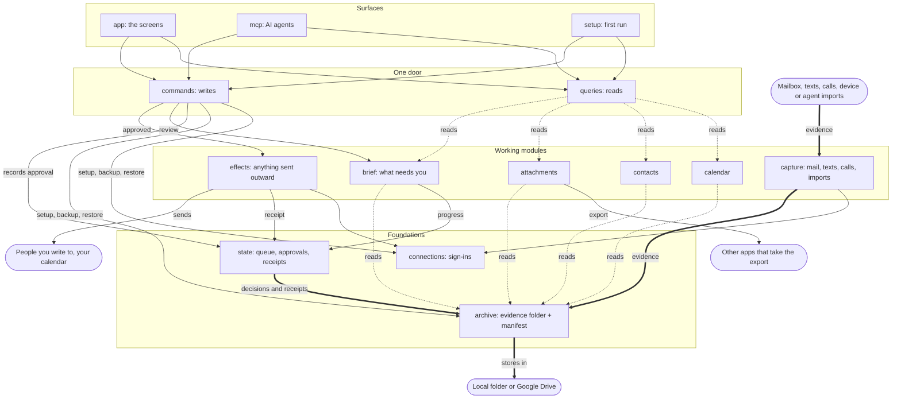

# Finished application target

Three ways in, one door, six working modules, three foundations.

Thick arrows are records being saved into the archive. Dotted arrows are reads. Plain arrows are calls, labelled where the call does one specific thing.

Three owners of the truth:

- **What happened** lives in `archive`. Originals are never rewritten.
- **What it means** lives in `brief`, `contacts`, `calendar` and `attachments`, with progress in `state`. It can be rebuilt from the archive, because the choices a person makes (a review, a contact merge, an approval) are saved into the archive as records too.
- **What was done about it** lives in `effects`. A sent reply or a calendar write happens once, after approval, and leaves a receipt. `state` holds the live receipt and `archive` stores the lasting copy, so a restore brings receipts back and nothing is sent twice.

Screens and agents use the same door, so a person and an agent never do the same thing two different ways. Things come in through `capture` only and go out through `effects` only.

Every module may read `contracts/`, and names the exact shapes it depends on. Anything that cannot be rebuilt from originals is saved into the archive, with two exceptions that stay on the computer and never enter the archive or a backup: account sign-ins, which `connections` owns, and the location of the evidence folder, which `setup` owns.

After a restore, an approved action that has no receipt is never sent automatically. It is checked with the provider or put back for approval.
